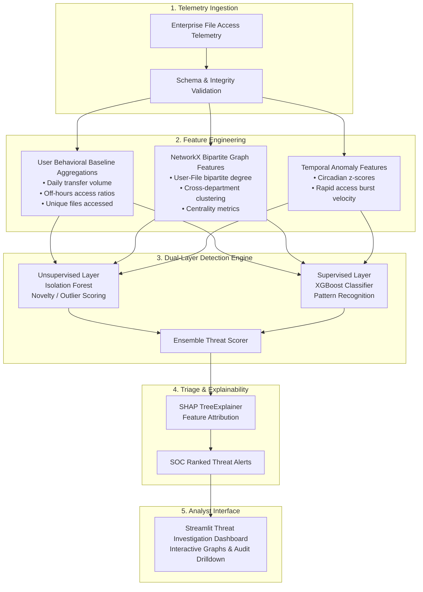

# 🛡️ Insider Threat & Data Exfiltration Detection

An end-to-end defensive cybersecurity machine learning system designed to detect anomalous insider behavior, lateral movement patterns, and unauthorized data exfiltration within enterprise file-access networks.

---

## 📌 Project Objective

Enterprise data exfiltration and insider threats represent critical cybersecurity risks that evade traditional boundary defenses (firewalls, perimeter IDS/IPS) because perpetrators operate with legitimate authentication and granted privileges.

This project builds a multi-layered defensive intelligence pipeline that:
1. Ingests file-access and data-transfer audit telemetry.
2. Extracts high-dimensional behavioral, temporal, and bipartite graph features.
3. Combines unsupervised anomaly detection (Isolation Forest / One-Class SVM) with supervised gradient boosting (XGBoost) and graph centrality analytics.
4. Explains individual alerts using SHAP (SHapley Additive exPlanations) for human-in-the-loop Security Operations Center (SOC) triage.
5. Provides an interactive Streamlit investigation dashboard for cybersecurity analysts.

---

## 🏗️ Planned Multi-Layer Architecture



---

## 📂 Repository Structure

```text
insider-threat-detection/
├── data/
│   ├── raw/                 # Unmodified raw access logs (e.g., access_logs.csv)
│   └── processed/           # Transformed datasets with engineered features
├── models/                  # Serialized trained models and scaler weights (.joblib, .pkl)
├── notebooks/               # Exploratory data analysis (EDA) and research notebooks
├── reports/
│   └── figures/             # Exported visualizations, ROC-PR curves, SHAP summary plots
├── src/
│   ├── data/                # Telemetry generation, ingestion, and validation scripts
│   ├── features/            # Behavioral aggregations, circadian metrics, and graph extractors
│   ├── models/              # Model training, isolation forest, XGBoost, and hyperparameter tuning
│   ├── evaluation/          # Confusion matrices, Precision@K, Cost-sensitive security metrics
│   └── visualization/       # Graph topology rendering and SHAP explanation visualizers
├── app/                     # Interactive Streamlit SOC investigation dashboard
├── tests/                   # Pytest automated test suite (schema, reproducibility, models)
├── docs/
│   └── interview_notes/     # Architectural rationale and interview preparation guides
├── .env.example             # Template for local environment configuration
├── .gitignore               # Strict security and data exclusion rules
├── requirements.txt         # Pinned Python package dependencies
└── README.md                # Project documentation and guide
```

---

## 🚀 Getting Started (Phase 1 Setup)

### Prerequisites
- Python 3.11 installed (or compatible Python 3.11+ environment)
- Git

### 1. Clone & Set Up Virtual Environment

```powershell
# Open terminal in project root
cd c:\insider-threat-detection

# Create a dedicated virtual environment with Python 3.11
py -3.11 -m venv .venv

# Activate the virtual environment (PowerShell)
.\.venv\Scripts\Activate.ps1
```

*(On macOS/Linux: `python3.11 -m venv .venv && source .venv/bin/activate`)*

### 2. Install Pinned Dependencies

```powershell
python -m pip install --upgrade pip
pip install -r requirements.txt
```

### 3. Generate Synthetic Access Telemetry

Generate 20,000 deterministic synthetic audit events modeling both benign enterprise workflows and 5 controlled insider threat scenarios:

```powershell
python -m src.data.generate_data --num-events 20000 --seed 42 --anomaly-ratio 0.05 --output data/raw/access_logs.csv
```

### 4. Run Data Quality & Schema Audit

Validate schema compliance, missing values, duplicates, and volume distributions:

```powershell
python -m src.data.validate_data --input data/raw/access_logs.csv
```

### 5. Run Test Suite

Run automated unit and integration tests using Pytest:

```powershell
pytest -v
```

---

## 🧪 Synthetic Data & Ground Truth Disclaimer

The synthetic access logs (`data/raw/access_logs.csv`) include an `is_anomaly` column representing synthetic ground truth.

> [!IMPORTANT]
> **Ground-Truth Safeguard**: The `is_anomaly` column is generated solely via controlled simulation rules to evaluate detection performance. It **must never** be included in model training matrices or feature engineering pipelines. Doing so would cause label leakage and invalidate model validity.

In production cybersecurity environments, absolute ground-truth labels are rarely available due to unconfirmed incidents, reporting delays, and stealthy adversaries. Synthetic benchmark labels provide a controlled baseline to measure detection recall, precision, and alert fatigue.

---

## 📅 Roadmap & Development Status

| Phase | Milestone | Status |
| :--- | :--- | :---: |
| **Phase 1** | Repository foundation, reproducible data generator, schema validation, Pytest suite | **Completed** |
| **Phase 2** | Exploratory Data Analysis (EDA) & baseline statistical profiling | *Next* |
| **Phase 3** | Behavioral & bipartite network feature engineering (NetworkX) | *Upcoming* |
| **Phase 4** | Anomaly detection (Isolation Forest) & Supervised classification (XGBoost) | *Upcoming* |
| **Phase 5** | Model explainability (SHAP) & Security cost evaluation (Precision@K) | *Upcoming* |
| **Phase 6** | Streamlit SOC analyst investigation dashboard | *Upcoming* |
